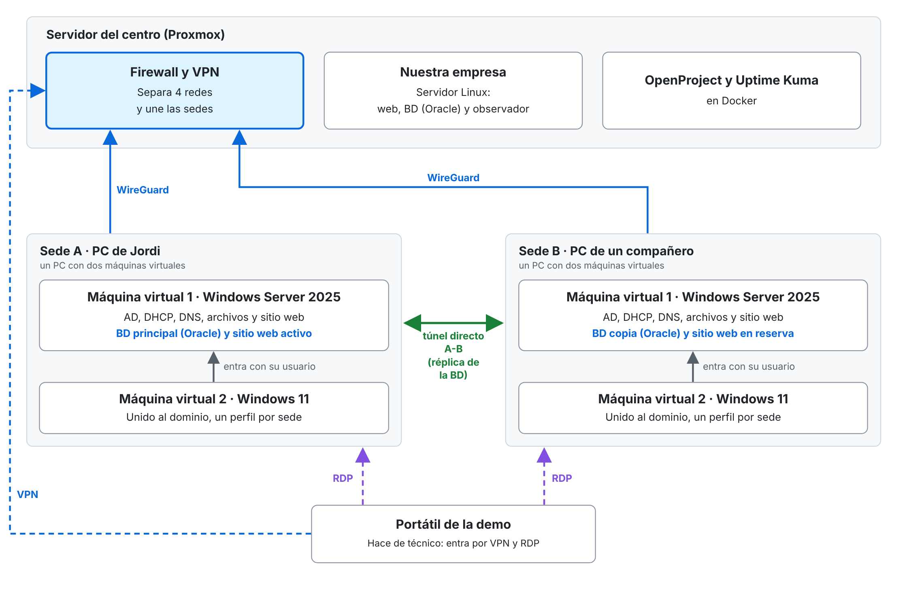
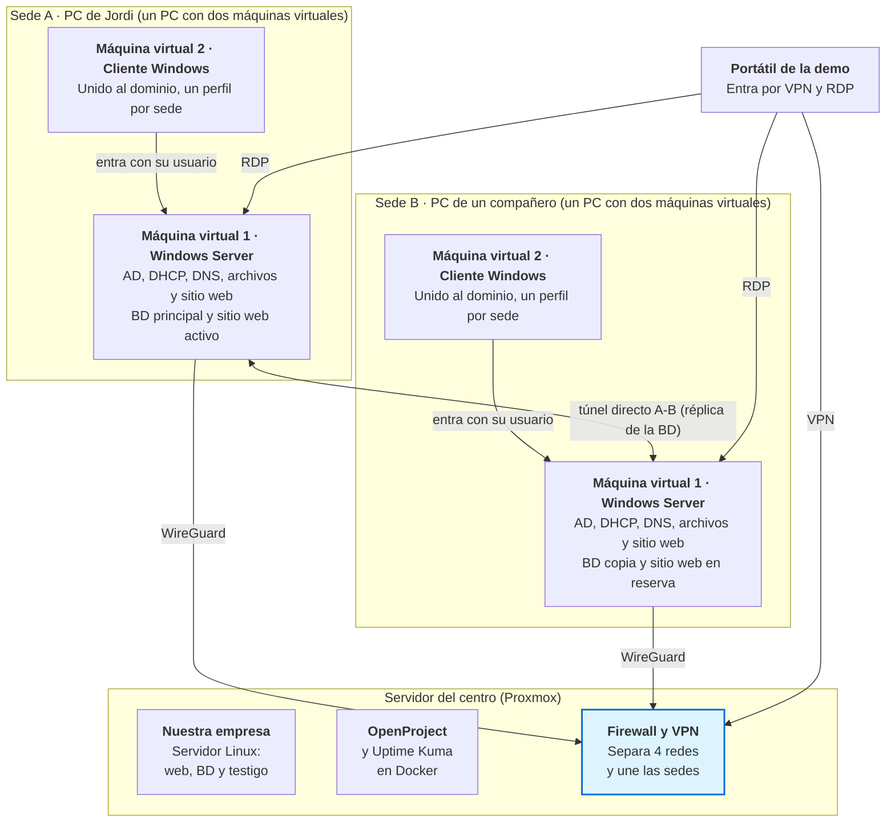

# Proyecto intermodular – Borrador de idea (v0.5)

18 de octubre de 2026

Este borrador propone dos empresas ficticias: la nuestra, una pequeña empresa de servicios informáticos con taller, y su primer cliente, una empresa de importación y distribución con dos sedes. Montaremos la infraestructura de nuestra empresa en un servidor del centro y la de la empresa cliente en dos equipos, una sede en cada uno (el PC de Jordi y, para la otra sede, el equipo de un compañero o un portátil que pediremos al centro), unidas por una VPN, y defenderemos el trabajo en 30-40 minutos. Es un borrador para aprobar entre todos; después redactaremos una hoja de ruta con las tareas concretas de cada uno.

> [!NOTE]
> **Nota sobre IPE II:** este documento cubre la parte técnica del proyecto. Lo que corresponde al módulo de Itinerario Personal para la Empleabilidad II (plan de empresa, modelo de negocio, lienzo, Lean Startup, nombres de las empresas y lo que más pida el módulo) irá en un documento aparte, enlazado con este, o en una sección propia más adelante.

## Contenido

1. [Resumen](#resumen)
2. [Qué está decidido y qué no](#qué-está-decidido-y-qué-no)
3. [Nuestra empresa](#nuestra-empresa-nombre-por-decidir)
4. [La empresa cliente](#la-empresa-cliente)
5. [Infraestructura y ubicación](#infraestructura-y-ubicación)
6. [Servicios y para qué sirven](#servicios-y-para-qué-sirven)
7. [La demostración y el acceso remoto](#la-demostración-y-el-acceso-remoto)
8. [Sitio web y base de datos](#sitio-web-y-base-de-datos)
9. [Cómo se autentican los usuarios en el sitio web](#cómo-se-autentican-los-usuarios-en-el-sitio-web)
10. [Herramientas de gestión y documentación](#herramientas-de-gestión-y-documentación)
11. [Alcance por prioridades](#alcance-por-prioridades)
12. [Limitaciones conocidas y cómo se arreglarían](#limitaciones-conocidas-y-cómo-se-arreglarían)
13. [Riesgos y planes B](#riesgos-y-planes-b)
14. [Contenidos por ver y dónde encajarían](#contenidos-por-ver-y-dónde-encajarían)
15. [Preguntas pendientes](#preguntas-pendientes)
16. [Notas](#notas)
17. [Glosario](#glosario)

## Resumen

Montamos dos empresas ficticias y las conectamos: la nuestra, de servicios informáticos, y su primer cliente, de importación y distribución.

- **Nuestra empresa** vive en un servidor Linux del centro (Proxmox). Tiene cuatro redes separadas, un firewall virtual, una web con blog, OpenProject, un panel de estado y su propia base de datos (Oracle Free).
- **La empresa cliente** vive en dos equipos, una sede en cada uno: el PC de Jordi (sede A) y el equipo de un compañero o un portátil del centro (sede B). Cada sede es un servidor Windows Server 2025 con todos los servicios y un ordenador cliente Windows 11.
- **Las dos sedes** se unen por VPN entre ellas y con el servidor del centro. La base de datos (PostgreSQL 18) tiene una copia principal en la sede A y otra de reserva en la B. Si cae la A, la B toma el relevo.
- **La defensa** dura 30-40 minutos. Un portátil del centro simulará el portátil de un técnico de nuestra empresa: entra en las dos empresas y vemos caer la sede A y recuperarse.
- **Lo que no montamos** y solo documentamos: las copias de seguridad completas, los SAI, la tienda y el taller de nuestra empresa, y las medidas de seguridad más avanzadas.

> [!IMPORTANT]
> **DECIDIDO, PENDIENTE DE CONFIRMAR CON ASGBD:** con medios gratuitos, solo PostgreSQL ofrece de serie réplica continua entre sedes. Por eso la empresa cliente usa PostgreSQL 18 (réplica y promoción manual) y nuestra empresa usa Oracle Free, que es lo que se trabaja en ASGBD. La promoción automática (Patroni) queda como opcional. Hay que confirmar con el docente que la réplica en PostgreSQL cuenta para el módulo.

## Qué está decidido y qué no

Esta tabla dice, de un vistazo, en qué terreno pisamos antes de ponernos a trabajar.

| Estado | Tema | Detalle |
| --- | --- | --- |
| Decidido | Reparto de equipos | Nuestra empresa, en el servidor del centro. Sede A, en el PC de Jordi (potente). Sede B, en el equipo del compañero con más recursos o en un portátil que pediremos al centro (16 GB DDR4 y SSD SATA), según cuál convenga más |
| Decidido | Sistemas | Linux y Docker en nuestra empresa. Windows Server 2025 y clientes Windows 11 Pro en las sedes, con los recursos mínimos. Usamos 2025 porque es la versión actual y en SRI apenas hemos trabajado con la 2022 |
| Decidido (supuesto) | Licencias | Licencias educativas para los Windows (Azure Dev Tools for Teaching o similar). Si no llegan, versión de evaluación de 180 días, ampliable con `slmgr /rearm`. Las licencias deben estar antes de instalar AD (ver riesgos) |
| Decidido | Máquinas virtuales | Un VirtualBox por sede, con dos MV (servidor y cliente). El servidor lleva dos adaptadores: red interna y puente |
| Decidido | Plantillas | El servidor y el cliente de la sede A, recién instalados y actualizados, se generalizan con Sysprep y se exportan (OVA) para montar la sede B sin instalar de cero |
| Decidido | VPN | WireGuard. En cada sede termina en la máquina virtual del servidor |
| Decidido | Seguridad de las sedes | Nivel 1: cortafuegos de Windows, administración solo por VPN y políticas por GPO. Básico, pero anotaremos las carencias y las mejoras que podemos hacer |
| Decidido | Base de datos de la empresa cliente | PostgreSQL 18 en el Windows Server de cada sede: principal en A, copia en B y promoción manual con un comando. La promoción automática con testigo (Patroni) es opcional, cuando todo lo demás funcione |
| Decidido | Base de datos de nuestra empresa | Oracle Free en Docker, en el servidor del centro. Un solo servidor sin réplica: la edición gratuita basta, y cubre lo que se trabaja en ASGBD |
| Decidido | Cuentas de los comerciales | Cuentas propias de la web, guardadas en la base de datos. Active Directory queda como mejora futura |
| Decidido | Acceso de los comerciales | VPN en el móvil (WireGuard), con un perfil personal por comercial. La alternativa con HTTPS y segundo factor queda documentada |
| Decidido | Descuentos | No acumulables: se aplica el mayor. El diseño detallado se hará en ASGBD |
| Decidido | Webs | nginx en las dos empresas. La del cliente, en cada sede. Certificados con openssl y una CA propia |
| Decidido | Herramientas | GitHub y OpenProject |
| Pendiente de confirmar | Réplica en PostgreSQL para ASGBD | Hay que preguntar al docente si cuenta para el módulo. Urgente |
| Por decidir | Nombres de las empresas | Entre todos. Bloquean el dominio de AD, los nombres DNS y los certificados. Mientras tanto se usan los marcadores `[PENDIENTE-NOMBRE-CLIENTE]` y `[PENDIENTE-NOMBRE-NUESTRA]` |
| Por decidir | Motivo de la caída de A | El gato (o mascota de la empresa) que pulsa el botón de apagado o accidente similar, a ser posible humorístico |
| Decidido | Túnel directo A-B | Obligatorio por el diseño de la base de datos: la réplica viaja por él. Necesita IP pública sin CGNAT y un puerto abierto en casa (se recomienda usar DNS dinámicos gratuitos) |
| Por decidir | FOG y proxy de salida | Deseables en nuestra empresa, si hay tiempo |
| Por decidir | Cortafuegos dedicado en las sedes | Solo si SAD lo exige |
| Solo documentado | Copias de seguridad, SAI y WDS | No se montan. Se explican con su estrategia |
| Solo documentado | Mejoras de seguridad | DMZ, detección de intrusiones, protección antiDDoS y alta disponibilidad real |
| Solo documentado | Cómo lo haría una empresa real | ERP con almacenes, base de datos central y tienda online separada. Con presupuesto, Oracle Enterprise con Data Guard |

## Nuestra empresa (nombre por decidir)

Somos una pequeña empresa de servicios informáticos con taller (reparación y montaje) que acaba de crecer para dar servicio a su primera empresa cliente. Además de reparar equipos, ahora diseñamos, desplegamos y mantenemos la infraestructura de otras empresas.

Para nosotros mismos contamos con:

- Un **pequeño servidor Linux**, alojado en el servidor del instituto, con la base de datos de clientes, trabajadores, proveedores, productos y reparaciones, y los servicios básicos: HTTPS, DNS, DHCP y copias de seguridad, además de otros que iremos aprendiendo.
- **5 terminales**: 4 estaciones de trabajo (dos en la tienda y dos en el taller) y un portátil de técnico, prestado por el centro (instituto), para simular el acceso desde fuera. En la tienda, un equipo hace de mostrador y otro de escritorio de presupuestos, donde está toda la información. Sistemas mezclados; los técnicos usarán Linux.
- **Un firewall virtual** (OPNsense o pfSense, por decidir) que separa cuatro redes: tienda, taller, equipos en reparación e invitados. Cada una llega al servidor solo a lo que necesita y entre ellas no hay acceso; los invitados solo salen a internet. El taller y los equipos en reparación tienen el mayor aislamiento posible, para que un virus no pase al portátil de un cliente.
- Pocos departamentos: especialistas en software y programación, y técnicos de reparación y montaje. Las gestiones (facturas, pagos, impuestos...) las lleva una gestoría externa.
- Una **web sencilla** de tarifas, servicios y contacto, con un pequeño blog de cuatro entradas (dos noticias ficticias y dos consejos prácticos). No recibe pedidos ni lleva base de datos. Se aloja en nginx con su propio certificado.

Detalle de seguridad y continuidad:

- **Copias de seguridad:** dos unidades físicas cifradas que se alternan. Una queda conectada al servidor y la otra sale del local, en manos del dueño o de un empleado de confianza.
- **SAI:** uno para el servidor y el equipo de la tienda, con tiempo suficiente para apagarlos de forma ordenada, y otro aparte para el taller. Un corte en mitad de una actualización de BIOS puede dejar una placa inservible.
- **Servidor seguro:** SSH solo con clave y solo por el túnel de la VPN, cortafuegos con «denegar por defecto» (ufw o nftables), actualizaciones automáticas y bloqueo de intentos fallidos (fail2ban). Ojo: Docker abre puertos por su cuenta y puede saltarse el cortafuegos. Se publican solo en la red interna y se comprueba con un escáner desde fuera.
- **Acceso del técnico a domicilio:** una VPN personal por técnico, SSH con clave y, en lugar de una consola abierta, una carpeta con herramientas portables de código abierto a la que accede por SFTP. Además consulta, desde la intranet web, los datos del cliente que necesita: el historial de reparaciones (equipo, avería, estado, garantía y contacto), con permiso de lectura y, como mucho, para añadir notas a la reparación. No ve facturación ni datos de otros clientes, y cada acceso queda registrado: hay datos personales, así que se aplica el mínimo necesario. Los técnicos ya llevan sus propios USB con herramientas, así que la demostración es sencilla.
- **Instalación de equipos por red (FOG), deseable:** sirve para reinstalar los equipos del taller. Para la demostración basta enseñar su panel funcionando.
- **Proxy de salida (Squid) para el taller**, opcional: filtra y registra la navegación por dominio, sin abrir el tráfico HTTPS.
- **Base de datos:** Oracle Free (la edición gratuita de Oracle) en un contenedor Docker. Al ser un solo servidor sin réplica, la edición gratuita basta, y es lo que se trabaja en ASGBD. Consume unos 2-3 GB de RAM, a tener en cuenta al pedir recursos en Proxmox.

## La empresa cliente

Nuestro primer cliente se dedica a la importación y distribución de artículos de regalo, y vende a tiendas y a clientes online. Tiene **dos sedes en grandes ciudades**, con entre 7 y 14 ordenadores cada una, repartidos en departamentos: comercial, import/export, diseño, contabilidad, RRHH, almacén y dirección.

Lo que necesita:

- **Identidad y permisos centralizados** en cada sede (Active Directory).
- **Conexión segura entre sedes** mediante VPN, con copias de seguridad.
- Una **zona de comerciales en el sitio web**, para los comerciales de calle: consultar el stock en tiempo real y ver el estado de pedidos e incidencias. Los comerciales no trabajan en las sedes: en el departamento comercial de cada sede hay encargados que coordinan a los comerciales de cada zona geográfica.
- Una **web para clientes**: catálogo, alta, modificar sus datos y hacer pedidos. Es la parte más compleja, porque exige datos siempre actualizados (stock, precios, productos, clientes). En la demostración la dejamos en lo mínimo: ver productos con su stock y crear un pedido.

Cómo es cada sede (la simulamos con dos máquinas virtuales):

- **Un servidor Windows Server 2025 que lo hace todo:** Active Directory, DHCP, DNS, carpetas compartidas, base de datos (PostgreSQL 18) y web. Es lo habitual en una empresa pequeña, y nadie de la oficina lo toca: solo nosotros.
- **Un cliente Windows 11 Pro** unido al dominio, como perfil representativo, con los recursos mínimos: solo tiene que demostrar que funciona. En la memoria explicaremos que los demás equipos (de 7 a 14 por sede) serían copias de ese perfil, con las mismas políticas (GPO).
- **Red:** el servidor tiene dos adaptadores, uno de red interna (la oficina) y otro en puente (salida a internet y a la VPN). Los trabajadores de la oficina solo tienen el interno y salen a través del servidor.
- **Seguridad de nivel 1:** cortafuegos de Windows con «denegar por defecto», perfil de red público en el adaptador externo, administración (RDP) solo por la VPN, cuentas de administrador separadas, directivas de contraseñas por GPO y bloqueo tras fallos.
- **Instalación de equipos por red:** el equivalente de FOG en Windows es WDS, que Microsoft ha recortado y retirará del todo a partir de la próxima versión de Windows Server. Por eso solo se menciona, con FOG o herramientas independientes como alternativa. Dejarlo preparado casi no ocupa disco: lo que pesa son las imágenes (unos cientos de MB la de arranque y varios GB la de instalación de Windows 11, a ojo).

Seguridad y continuidad del cliente:

- **SAI en la sede A:** debe aguantar unas dos horas de corte y alimentar el servidor, la pantalla, el módem o router y el switch, para que sigan funcionando la VPN, la web y los comerciales de calle. Los equipos de oficina son prescindibles. El SAI será de gama media, con regulador de tensión (AVR) y onda senoidal pura, y apagado ordenado del servidor si el corte se alarga. La capacidad se calcula con el consumo medido (vatios por horas, con margen). No se plantean medidas de gran centro de datos, como líneas eléctricas independientes o doble suministro.
- **Copias de seguridad (solo en la documentación, no se montan):** una copia cruzada entre sedes por VPN durante la noche y una copia física automática en un disco conectado al servidor. Suponemos ambas sedes con al menos 1 Gbps contratado y entre 10 y 15 GB por copia completa.
- **Estrategia de copias:** en la física, una completa semanal y un incremental diario; en la cruzada, una completa cada noche. La base de datos se copia con la herramienta del propio motor o con instantáneas consistentes, no copiando ficheros en caliente.
- **Buenas prácticas:** cifrar los discos, tener dos y alternarlos, sacar uno del local y desconectarlo del servidor para que un ransomware no lo cifre con el resto. Se sigue la regla 3-2-1 (tres copias, dos soportes y una fuera del sitio).
- **Lo que sí se hace en la demostración:** restaurar una carpeta pequeña desde un USB conectado a la máquina virtual del servidor de la sede A (Jordi).

## Infraestructura y ubicación

Montamos todo en cuatro sitios, cada uno con un propósito:

- **Servidor del centro (Proxmox, por confirmar).** Es el único punto siempre encendido y con conexión estable. Aloja el único servidor Linux del proyecto, el de nuestra empresa, con Docker: su web, OpenProject, Uptime Kuma y la base de datos Oracle Free. Además lleva el firewall virtual y el concentrador de la VPN, y, si montamos Patroni, hace de testigo de la base de datos de la empresa cliente. Necesitamos que nuestro entorno quede aislado del de otros grupos.
- **Sede A: el equipo de Jordi (6 núcleos y 12 hilos, 32 GB).** Un solo PC con dos máquinas virtuales (servidor y cliente). Lleva la base de datos principal. También sirve de equipo de desarrollo y de plan B. Mientras no haya servidor en el centro, aloja además la MV de OpenProject.
- **Sede B: el equipo de un compañero o un portátil prestado por el centro (16 GB DDR4 y SSD SATA).** Estará en casa de un compañero, con las mismas dos máquinas virtuales, la copia de la base de datos y la web en reserva. Sea cual sea el equipo, debe tener permisos de administrador, la virtualización activada en la BIOS y poder desactivar la seguridad basada en virtualización (VBS) de Windows; en el portátil del centro, esto hay que pedirlo expresamente.
- **Portátil de la demostración.** Un portátil prestado por el centro, conectado a un proyector o pantalla grande, que hace de técnico: entra por VPN y escritorio remoto a los servidores de cada sede y al de nuestra empresa. Si la sede B también va en un portátil del centro, serán dos portátiles distintos.

Esquema de la red del proyecto (servidor del centro, dos sedes y portátil de la demo). Es un diagrama escrito como texto: GitHub lo dibuja solo y se puede editar aquí mismo, sin descargar nada.

Esquema de la red del proyecto (servidor del centro, dos sedes y portátil de la demo):

Ver o editar el diagrama como texto (Mermaid)

Las sedes y el portátil de la demo salen hacia el servidor del centro, así que no hace falta abrir puertos en casa de nadie, salvo para el túnel directo entre sedes (en el diagrama, entre las dos sedes), que sigue funcionando aunque el centro caiga. Es obligatorio por el diseño de la base de datos: la réplica viaja por él.

**Cómo se conectan las máquinas virtuales.** El servidor de cada sede hace de router de su oficina:

| Máquina virtual | Adaptador | Tipo | Para qué |
| --- | --- | --- | --- |
| Servidor | 1 | Red interna | La red de la oficina: DHCP, DNS, AD, archivos |
| Servidor | 2 | Puente | Salir a internet y a la VPN (centro y otra sede) |
| Cliente Windows | 1 | Red interna | Solo la oficina; sale a internet a través del servidor |

Hay cuatro cosas que configurar con cuidado:

1. **DHCP solo en la red interna**, para no competir con el router de casa y repartir direcciones a otros aparatos.
2. **DNS y Active Directory solo en la interfaz interna.** Hay que desactivar el registro DNS de la tarjeta externa.
3. **Reenvío y NAT** en el servidor (rol de Acceso remoto, enrutamiento y NAT). Sin ellos, los clientes llegan al servidor pero no salen.
4. **Ruta de vuelta.** El portátil del técnico debe saber que la red de la oficina está detrás del túnel, y los equipos de la oficina deben usar la IP interna del servidor como puerta de enlace.

**Recursos de las máquinas virtuales.** Discos dinámicos (solo ocupan lo que se usa) y EFI activado:

| Sede | Máquina virtual | Núcleos | RAM | Disco |
| --- | --- | --- | --- | --- |
| A (PC de Jordi, 32 GB) | Servidor `SEDEA-SRV01` | 4 | 6 GB | 80 GB |
| A | Cliente Windows 11 | 2 | 3 GB | 64 GB |
| A (provisional) | OpenProject (Ubuntu Server) | 2 | 4 GB | 40 GB |
| B (equipo de un compañero o portátil del centro, 16 GB como mínimo) | Servidor sede B | 2-4, según el equipo | 5 GB | 80 GB |
| B | Cliente Windows 11 | 2 | 3 GB | 64 GB |

En la sede A quedan unos 8 GB para el anfitrión y en la B unos 7. El servidor B lleva algo menos de memoria porque su base de datos es la copia y su web está en reserva. Ninguna MV debe tener más núcleos de los que tiene físicamente su anfitrión. La red interna de cada sede debe llamarse igual en el servidor y en el cliente (por ejemplo, `sedeA-lan`).

**Antes de crear las MV en un anfitrión.** Windows 11 puede tener activo su propio hipervisor sin avisar (seguridad basada en virtualización, VBS, que activan la integridad de memoria o la protección de inicio de sesión de Windows Hello). Con él, VirtualBox funciona en modo lento (el icono de la tortuga verde) y algunas instalaciones se cuelgan. Hay que desactivarlo y comprobar en `msinfo32` que aparecen las líneas de «Requisitos de Hyper-V». El procedimiento paso a paso irá en el manual de montaje de las sedes.

**Plantillas.** Para no instalar dos veces lo mismo, el servidor y el cliente de la sede A, recién instalados, actualizados y en español (sin roles ni configuración propia de la sede), se generalizan con Sysprep (`sysprep /generalize /oobe /shutdown`) y se exportan como OVA. La sede B los importa con direcciones MAC nuevas y continúa desde ahí. Un controlador de dominio ya configurado nunca se clona.

**Direcciones.** Manejamos cuatro grupos de IP: la red real de cada casa, la IP del adaptador puente de cada servidor, la red interna de cada sede, y el túnel. Las dos redes internas deben ser distintas entre sí y distintas de la de casa, y la IP puente debe quedar fuera del rango DHCP del router de casa. Haremos una tabla de IPs desde el principio.

**IP dinámica.** En la empresa real, las sedes tendrían IP fija: la IP dinámica es una limitación de la simulación, porque las sedes estarán en casas. Las IP de casa cambian. Los túneles hacia el centro no se ven afectados, pero el túnel directo A-B sí, y es obligatorio. El router de Jordi, y probablemente los de los compañeros, traen DNS dinámico integrado: el túnel apunta a un nombre y no a una IP. No afecta al rendimiento, porque el tráfico no pasa por el servicio, pero algunos servicios gratuitos piden confirmar el nombre cada cierto tiempo. WireGuard resuelve el nombre al arrancar, así que si la IP cambia hay que reiniciar el túnel. Tampoco resuelve el CGNAT: hay que comprobar que ninguna sede está detrás de uno, comparando la IP que muestra el router con la que se ve en una web de «mi IP».

## Servicios y para qué sirven

Esta es la lista de servicios, dónde van y qué módulos tocan. La columna de módulos es una primera estimación y hay que confirmarla con los docentes.

| Servicio | Dónde | Para qué | Módulos (a confirmar) |
| --- | --- | --- | --- |
| Hipervisor Proxmox | Servidor del centro | Alojar nuestras máquinas virtuales, aisladas de otros grupos | SRI, ASO |
| Firewall virtual (OPNsense o pfSense) | Servidor del centro | Separar las cuatro redes de nuestra empresa y aislar los equipos en reparación | SAD |
| VPN (WireGuard) | Concentrador en el servidor del centro; sedes, portátil y móviles de los comerciales como clientes | Unir las sedes y permitir el acceso remoto seguro | SRI, SAD |
| DHCP y DNS | Nuestro servidor Linux y cada sede (Windows Server) | Direcciones y nombres de red | SRI |
| Active Directory | Cada sede | Usuarios, grupos por departamento y políticas (GPO) | ASO |
| Carpetas compartidas | Cada sede | Archivos por departamento, con permisos | ASO |
| Base de datos con copia (PostgreSQL 18) | Windows Server de cada sede (principal en A, copia en B) | Datos de pedidos, stock y clientes con alta disponibilidad | ASGBD |
| Base de datos de nuestra empresa (Oracle Free) | Servidor Linux del centro (Docker) | Clientes, trabajadores, proveedores, productos y reparaciones | ASGBD |
| Testigo de la base de datos, opcional | Servidor Linux del centro | Desempatar si A y B discrepan sobre quién ha caído (solo con Patroni) | ASGBD, SAD |
| Sitio web en Python con nginx | Cada sede (activa en A, en reserva en B) | Pedidos de comerciales y clientes con una sola base de datos | IAW |
| Web de nuestra empresa y blog | Servidor Linux del centro | Información y contacto, con su propio certificado | IAW |
| Nginx y certificados | Ambas empresas | HTTPS con certificados de openssl y una CA propia | IAW, SRI |
| OpenProject | Servidor Linux del centro (Docker); provisionalmente, en una MV del PC de Jordi | Planificar y repartir el trabajo del grupo | Contenedores |
| Uptime Kuma | Servidor Linux del centro (Docker) | Panel con el estado de toda la infraestructura y un script que avisa de que la copia del día se ha hecho | Contenedores, SAD |
| SFTP restringido a una carpeta | Servidor Linux de nuestra empresa | Que el técnico acceda a una carpeta con herramientas portables | ASO, SRI |
| FOG, deseable | Servidor Linux de nuestra empresa | Reinstalar equipos del taller por red | SRI |
| Proxy de salida (Squid), opcional | Servidor Linux de nuestra empresa | Filtrar y registrar la navegación del taller por dominio | SRI, SAD |
| WDS, solo documentado | Cada sede | El equivalente de FOG en Windows (en desuso) | SRI |
| Copias de seguridad, solo documentado | Cada empresa | Cada sede guarda la copia de la otra, más una copia física cifrada | SAD, ASGBD |
| Intranet de reparaciones | Servidor Linux de nuestra empresa | Que el técnico consulte el historial de reparaciones de un cliente | IAW, ASGBD |

## La demostración y el acceso remoto

Dura como máximo 30-40 minutos. Este es el guion propuesto, aún por pulir:

1. **Estado de partida.** Panel de Uptime Kuma con toda la infraestructura simulada en verde (servidores, VPN, webs y base de datos) y un vistazo a las dos webs desde el portátil del técnico.
2. **El técnico entra en nuestra empresa.** Conecta por VPN, abre una sesión SSH con clave y accede por SFTP a la carpeta de herramientas portables y consulta en la intranet el historial de reparaciones de un cliente. No ve nada más.
3. **El técnico entra en la empresa cliente.** Desde el mismo portátil, escritorio remoto al servidor y al equipo de oficina de la sede, con un usuario de un departamento y sus propios permisos.
4. **Cae la sede A.** Motivo por decidir: el gato que pulsa el botón de apagado o similar. Se simula con un apagado brusco de la máquina virtual. Uptime Kuma marca en rojo la sede A. El técnico promueve la copia de la sede B con un comando (con el chiste del administrador al que despiertan a las tres de la mañana) y la web sigue funcionando desde ahí. Si llegamos a montar Patroni, la promoción la hace sola el testigo.
5. **El técnico comprueba que B sigue sirviendo.** Y llama a la sede para que echen al gato.
6. **El técnico levanta A y recupera.** Restaura una carpeta pequeña desde un USB conectado a la máquina virtual del servidor de la sede A.
7. **Si da tiempo.** Una compra de prueba en la web del cliente, para ver cómo cambia la base de datos.

**Cómo se controla todo a distancia.** El portátil entra por la VPN del proyecto. A las máquinas Windows de cada sede entra por escritorio remoto (RDP); desde un portátil con Linux sirve un cliente como Remmina. Las máquinas virtuales Windows deben ser Pro o Enterprise, y los equipos anfitriones también para entrar a ellos: el de la sede A es Pro y el de la B hay que comprobarlo (la edición Home no acepta escritorio remoto entrante; la Education, sí). Al servidor Linux se entra por SSH y por la consola web de Proxmox; a las webs, a Uptime Kuma y a OpenProject, se entra con el navegador. Para apagar la máquina virtual de la sede A, escritorio remoto al PC de Jordi y la línea de comandos de VirtualBox. No usaremos TeamViewer ni otros servicios parecidos: sacan la conexión por su nube y contradicen el diseño sobre VPN.

**El USB en la máquina virtual.** Se asigna a la máquina virtual del servidor de la sede A. En VirtualBox, los puertos USB 2.0 y 3.0 piden el Extension Pack, así que hay que probarlo con tiempo.

**Qué simulamos de nuestra empresa.** No montamos la tienda, el taller ni la red de invitados: se diseñan y se documentan (esquema y tabla de reglas del firewall). Solo simulamos el acceso de un técnico que está fuera: con el portátil prestado por el centro, consulta por VPN los datos de su cliente en nuestro servidor y, desde ese mismo portátil, entra en el servidor de la empresa cliente.

**El portátil.** Es del centro, con Linux o con Windows 11 si se prefiere, y habrá que preguntar a quien gestione esos portátiles. Va conectado a un proyector o pantalla grande: no se enseñan contraseñas ni claves, y se prueba la resolución antes del día de la presentación. Si la sede B va en otro portátil del centro, al centro le pediremos dos.

**Comprobación del día antes y del mismo día.** Las IP de casa cambian, así que cada uno:

1. Anota su IP pública.
2. La compara con la que hay en la configuración del túnel.
3. La corrige si no coincide y reinicia el túnel.
4. Comprueba que hay un «último handshake» reciente (en WireGuard, con `wg show`).
5. Hace ping a la otra sede por la dirección del túnel.
6. Repite todo antes de entrar a la defensa.

Ensayo general unos días antes, y el móvil como punto de acceso si la red del centro bloquea la VPN.

## Sitio web y base de datos

La idea: un solo sitio web en Python, con una única base de datos y dos zonas según el tipo de usuario: la pública, para clientes, y la de comerciales.

- **Comercial:** consulta el stock, crea pedidos y clientes, y ve el estado de pedidos e incidencias.
- **Cliente:** consulta el catálogo, se da de alta, modifica sus datos, hace pedidos y comunica incidencias.

La zona de comerciales es una web adaptada al móvil (no una app nativa), en una dirección propia (un subdominio o una ruta) que nginx solo permite desde la red de la VPN. La zona pública está abierta. Se abre desde cualquier móvil con la app de WireGuard activada y se puede añadir como acceso directo a la pantalla de inicio. En cada sede se publica con nginx para Windows y Python, dejado como servicio de Windows. El framework dependerá de lo que veamos en IAW. Las dos zonas comparten programa y base de datos, así que un fallo en una podría afectar a la otra: se separan con permisos bien definidos y, si la empresa crece, con servidores distintos. Conocemos el límite: nginx en Windows rinde menos que en Linux, aunque a este tamaño no se nota, y si la empresa cliente crece, incorporará un servidor específico para la web o se buscará un servicio externo.

**Stock y precios.** El stock se guarda por producto y por almacén (sede). Los precios se leen siempre de la base de datos al hacer el pedido. Hay descuentos por campaña (con fechas), por tipo de producto o por tipo de cliente. No son acumulables: se aplica el mayor. El pedido guarda el precio y el descuento aplicados, para que cambiar una campaña no altere pedidos pasados. El diseño detallado se hará en el chat de ASGBD. El descuento de stock se hace en una sola operación que solo se cumple si hay existencias: si dos clientes compran el último producto a la vez, la base de datos deja pasar a uno y rechaza al otro.

**Base de datos con copia.** Hay una única base de datos principal, en la sede A, y una copia que recibe los cambios de forma continua por el túnel directo entre sedes, en la sede B. Todas las escrituras (pedidos, altas de clientes, entradas de stock) van a la principal, también las que se hacen desde la sede B. Es replicación y alta disponibilidad, no una base de datos distribuida en sentido estricto. Descartamos fragmentarla porque no aporta valor a una empresa de este tamaño, y así lo justificaremos en la memoria. Si los docentes piden más profundidad, la ampliamos poco a poco.

**Cómo se actualiza la copia.** Cada cambio en la base de datos principal (un pedido, una entrada de stock) se anota en un registro de transacciones. Ese registro viaja por el túnel directo hasta la sede B, que repite los mismos cambios en el mismo orden. Con la réplica asíncrona, la principal confirma el cambio sin esperar a la copia, así que esta va unos instantes por detrás (normalmente milisegundos o segundos si la conexión va bien): es casi tiempo real, no tiempo real. Con la síncrona, la principal espera a la copia antes de confirmar: no se pierde nada, pero cada operación es más lenta y, si cae el túnel, la principal puede quedarse bloqueada. Elegimos asíncrona y documentamos el riesgo. Si alguien necesita el stock exacto, lo consulta en la principal y no en la copia. Uptime Kuma puede vigilar el retraso de la réplica como extra.

> [!IMPORTANT]
> **MOTOR ELEGIDO: PostgreSQL 18.** Su réplica continua (streaming replication) es gratuita, funciona en Windows Server 2025 y la promoción manual es un solo comando. La promoción automática necesita herramientas externas: la más usada, Patroni, está pensada para Linux, aunque existe un instalador para Windows. Queda como opcional. Oracle, el motor que se trabaja en ASGBD, solo ofrece réplica y promoción automática (Data Guard con Fast-Start Failover y un observador que hace de testigo) en la edición Enterprise, de pago. Por eso Oracle Free se usa en nuestra empresa, donde no hace falta réplica.

**Si cae la sede A:**

1. El técnico comprueba (en Uptime Kuma) que A no responde y que B sí.
2. Promueve B a principal con un comando, y la web de B pasa a atender los pedidos.
3. Los comerciales siguen entrando por el mismo nombre, que ahora apunta a B (con un TTL corto y un servidor DNS en cada sede).

Si montamos Patroni (opcional), los pasos 1 y 2 los hace solo el testigo, en nuestro servidor del centro, y la promoción manual queda como respaldo por si el testigo no está disponible o cae a la vez que A. Cuando A vuelve, se pone al día desde B y se reincorpora como copia. Eso es manual y no entra en la demostración. Con réplica asíncrona pueden perderse los últimos segundos: un pedido a medias en el instante de la caída se pierde, y si la sesión del comercial se guarda en la base de datos, sigue dentro; si no, tiene que entrar de nuevo.

**Cómo lo haría una empresa real (para la memoria).** En una empresa de este tamaño es habitual un ERP con almacenes por sede, una base de datos central, a menudo en la nube, una línea de respaldo (4G o 5G) en cada sede y una tienda online separada que recibe el stock del ERP. Elegimos la réplica entre sedes porque nos permite demostrar ASGBD y SAD, y lo decimos con claridad. Con presupuesto, la base de datos replicada sería Oracle Enterprise con Data Guard, que hace la promoción automática de serie.

Si la tienda online se nos va de las manos, la simplificamos (solo catálogo y alta de clientes) o la dejamos fuera.

## Cómo se autentican los usuarios en el sitio web

Cómo entra cada tipo de usuario:

- **Comerciales de calle:** no trabajan en las sedes y no tienen cuenta del dominio. Entran con una cuenta propia de la web, guardada en la base de datos con la contraseña cifrada, y su rol les da acceso solo a su parte. Sus encargados de zona, que sí trabajan en el departamento comercial de la sede, tienen un rol propio para ver y gestionar a los comerciales de su zona. El acceso es siempre por HTTPS y solo a través de la VPN: el móvil del comercial lleva la app de WireGuard (gratuita) con un perfil personal, que se entrega con un código QR y se instala una sola vez. Cada comercial tiene su propia clave, así que se puede retirar el acceso a uno solo sin afectar al resto, por ejemplo si pierde el móvil. Mejora opcional: un segundo factor con código temporal.
- **Clientes:** tienen cuenta propia en la web, con la contraseña guardada cifrada (hash) en la base de datos. Acceden por HTTPS a través del proxy, sin VPN, y solo ven sus datos y sus pedidos.
- **Permisos por rol:** cada vista (comercial o cliente) muestra solo lo que corresponde a su rol.
- **Decidido:** las cuentas de los comerciales viven en la base de datos, que se replica: si cae la sede A y B toma el relevo, siguen entrando sin hacer nada. Como mejora futura, la integración con Active Directory, que exigiría un único dominio con un controlador en cada sede.

**Alternativa sin VPN en el móvil (mejora futura).** Publicar la zona de comerciales en internet con HTTPS y un segundo factor (código temporal). Es más cómodo para el comercial, pero deja esa zona visible en internet y depende por completo de la contraseña y del segundo factor. Elegimos la VPN por seguridad y por coherencia con el diseño. En una empresa real, con IP fija en las sedes, los comerciales se conectarían a la VPN de su propia sede.

## Herramientas de gestión y documentación

Proponemos combinar **GitHub** y **OpenProject**. GitLab queda descartada por parecer demasiado orientada al desarrollo.

- **GitHub**: código del sitio web y documentación del proyecto, para que quede claro quién aporta qué (aunque esto último no me parece importante, personalmente).
- **OpenProject (edición Community, gratuita)**: planificación, hitos y reparto de tareas. Lo alojaríamos nosotros en Docker, en el servidor del centro, como un servicio más del proyecto. No necesitamos la versión en la nube de pago.
- No lo expondremos a internet: solo accesible por VPN o detrás del proxy con HTTPS.

Decidido: usaremos OpenProject sí o sí. Puede que no nos resulte imprescindible, pero deja a la vista cómo organizamos el proyecto. Queda pendiente comprobar en qué edición está la integración con GitHub.

**Estado actual.** Mientras el centro no ceda el servidor, OpenProject funciona en una MV de Ubuntu Server con Docker Engine (no Docker Desktop) en el PC de Jordi, con la receta oficial de Docker Compose y la versión fijada (17.9.2), para ensayar lo mismo que se hará en el servidor. Los compañeros entrarán por una VPN a una dirección interna del túnel, que se mantendrá igual en el servidor del centro: el día de la mudanza solo habrá que cambiar el perfil de WireGuard en cada equipo. La migración se hace copiando la base de datos y los adjuntos a una instalación con la misma versión.

## Alcance por prioridades

Primero la infraestructura y después el sitio web: si el sitio web luce pero la promoción de la copia no funciona, se va a notar.

1. **Imprescindible**: Active Directory en cada sede, DHCP y DNS, VPN entre sedes, firewall virtual con las cuatro redes de nuestra empresa, nginx con las dos webs y sus certificados, base de datos con copia (PostgreSQL) y promoción manual, y la restauración de una carpeta pequeña desde un USB. Las copias de seguridad completas y los SAI solo se documentan.
2. **Deseable**: sitio web en Python con las dos zonas, Uptime Kuma con un script que avise de que la copia del día se ha hecho, y FOG en nuestra empresa.
3. **Opcional**: promoción automática con testigo (Patroni), una vez que todo lo demás funcione; tienda online completa con compra de prueba en la demostración, proxy de salida en el taller, túnel directo entre sedes con DNS dinámico, y un cortafuegos dedicado en las sedes si SAD lo pide.

Simulamos un cliente Windows unido al dominio por sede, como perfil representativo.

## Limitaciones conocidas y cómo se arreglarían

Somos conscientes de estas limitaciones y las explicaremos en la memoria y en la defensa, cada una con su solución futura.

| Limitación | Qué haríamos si la empresa crece |
| --- | --- |
| El servidor de cada sede hace de router, controlador de dominio, base de datos y web a la vez | Un cortafuegos dedicado por sede (OPNsense o pfSense) y el servidor solo en red interna |
| No hay DMZ | Una zona intermedia para la web, separada de la red de oficina |
| Sin protección frente a ataques de denegación de servicio de volumen | Protección del operador o un servicio antiDDoS delante de la web |
| Sin detección de intrusiones | IDS/IPS (por ejemplo Suricata) y registros centralizados |
| El concentrador de la VPN está en un único sitio | Un punto de entrada VPN por sede con IP fija; en una empresa real las sedes se conectarían entre sí con IP fija y el servidor del centro no haría de concentrador; los comerciales se conectarían a la VPN de su propia sede |
| Web con nginx en Windows Server | Un servidor web dedicado, probablemente Linux |
| Base de datos con dos nodos y promoción manual | Oracle Enterprise con Data Guard y Fast-Start Failover, Patroni con testigo, o la base de datos en un servicio gestionado en la nube |
| Réplica asíncrona: pueden perderse los últimos segundos | Réplica síncrona, a costa de rendimiento |
| Nuestro servidor Linux no tiene alta disponibilidad | Un segundo nodo en Proxmox y copias fuera del centro |
| IP dinámica en la simulación (las sedes reales tendrían IP fija) | Nada: la empresa real tendría IP fija. En la simulación se usa DNS dinámico |
| Copias de seguridad solo documentadas | Un plan real con restauraciones periódicas y una copia fuera del sitio |

## Riesgos y planes B

El mayor riesgo es depender a la vez de tres sitios (el centro y dos casas) el día de la defensa. Estos son los planes de respaldo:

| Riesgo | Plan B |
| --- | --- |
| El centro no nos cede el servidor, o lo comparte sin aislamiento suficiente | Montar todo en el equipo de Jordi (o uno más potente), con las sedes como redes internas de VirtualBox |
| Una conexión doméstica falla (IP dinámica, CGNAT, router, corte) | Comprobar la IP el día antes y el mismo día; si aun así falla, desplegar esa sede en el equipo de Jordi |
| La red del centro bloquea la VPN | Preguntar al docente de SRI por adelantado; el móvil como punto de acceso |
| El equipo de la sede B (de un compañero o del centro) no tiene recursos suficientes, permisos de administrador, virtualización, o tiene políticas que impiden desactivar la VBS | Medirlo y comprobarlo pronto, y elegir entre el equipo del compañero y el portátil del centro el que mejor cumpla; si ninguno sirve, el equipo de Jordi asume esa sede |
| El hipervisor de Windows (VBS, integridad de memoria, Windows Hello) se queda activo en un anfitrión: VirtualBox va lento y las instalaciones se cuelgan | Desactivarlo antes de crear las MV y comprobarlo en `msinfo32`, siguiendo el manual |
| Se instala AD antes de decidir los nombres: renombrar un dominio obliga a rehacer DNS y certificados | No instalar AD hasta cerrar los nombres y la pregunta de ASO; mientras tanto, los marcadores `[PENDIENTE-NOMBRE-...]` |
| Se instala AD sobre la versión de evaluación: un controlador de dominio no puede convertirse a la versión con licencia | Conseguir las licencias educativas antes de promover el controlador; si no llegan, seguir con la evaluación y ampliarla con `slmgr /rearm` |
| La evaluación de Windows Server caduca antes de la defensa | Alarma diez días antes de la fecha que da `slmgr /xpr` en cada servidor, y `slmgr /rearm` con reinicio |
| El USB no se reconoce en la máquina virtual (en VirtualBox, USB 2.0 y 3.0 piden el Extension Pack) | Probarlo con tiempo y dejar la carpeta de prueba ya preparada |
| Confusión entre las IP de los equipos reales y las de las máquinas virtuales | Tabla de IPs fijas desde el principio |
| La promoción automática de la copia (Patroni) no se consigue montar | Promoción manual con un comando, que es lo previsto, y la automática documentada |
| La réplica en PostgreSQL no cuenta para ASGBD | Preguntarlo cuanto antes; reforzar la parte de Oracle en nuestra empresa (usuarios, permisos, copias, auditoría) |
| Se cae algo el día de la defensa | Vídeos grabados de cada demostración clave, para proyectarlos y explicar en directo |
| El túnel directo A-B no se puede montar (CGNAT, puerto cerrado en casa) | La réplica depende de él: se comprueba el primer día y, si falla, se montan las dos sedes en el equipo de Jordi |

El guion de la demostración está en su apartado. Habrá que ensayarlo unos días antes y, una vez más, con el proyector.

## Contenidos por ver y dónde encajarían

El proyecto está pensado como un esqueleto al que se le enganchan piezas: lo caro de cambiar son los cimientos (dominio, motor de base de datos, VPN y direcciones), y ya están decididos o en espera de forma controlada. Lo que vaya saliendo en clase será, casi siempre, un añadido pequeño o una sección más de la memoria. No hace falta meterlo todo: basta con que cada módulo tenga su parte visible.

| Módulo | Lo que suele verse | ¿Lo cubre el proyecto? | Si no, cómo encajaría |
| --- | --- | --- | --- |
| ASO | Dominios, AD, GPO, LDAP, integración Windows-Linux, scripts, servicios y monitorización | Casi todo | Scripts de PowerShell o Bash (altas masivas de usuarios, copias); quizá OpenLDAP o Samba, documentado |
| SRI | DNS, DHCP, servidores web, FTP, correo, proxy, acceso remoto, NAT y VPN | Casi todo, menos el correo | Un servidor de correo en Docker en nuestra empresa, que además serviría para los avisos de OpenProject |
| IAW | Servidores web, CMS, PHP, despliegue y contenedores | Sí | Si piden un CMS, el blog de nuestra empresa pasa a ser un WordPress en Docker |
| ASGBD | Instalación, usuarios, permisos, auditoría, copias y alta disponibilidad | De sobra | PostgreSQL con réplica en las sedes y Oracle Free en nuestra empresa |
| SAD | Seguridad física, copias, criptografía, cortafuegos, proxy, VPN, IDS, alta disponibilidad y normativa | Casi todo | Copias cifradas y firmadas con GPG; un apartado de RGPD en la memoria |

Cada mes habrá un hito en OpenProject, «Revisión de contenidos nuevos», en el que el grupo repasa lo visto y decide qué se engancha y qué no.

## Preguntas pendientes

Para los docentes y el centro:

- [ ] **ASGBD, urgente:** ¿cuenta para el módulo que la réplica entre sedes se haga con PostgreSQL 18, dejando Oracle Free para la base de datos de nuestra empresa? ¿Qué edición de Oracle instala el manual del curso?
- [ ] **SAD:** ¿vale el nivel 1 de seguridad en las sedes, con las mejoras documentadas, o se espera un cortafuegos dedicado por sede? ¿Qué protección frente a denegación de servicio se espera?
- [ ] **Centro (Proxmox):** ¿tendremos usuario propio con cuotas de RAM, CPU y disco? ¿Podemos crear redes virtuales propias? ¿Se puede abrir un puerto UDP desde fuera para la VPN? ¿Hay copias o snapshots de las máquinas?
- [ ] **Centro (portátiles):** ¿pueden prestarnos un portátil para el técnico de la demostración y, si hace falta, otro para la sede B? El de la sede B necesitaría permisos de administrador, la virtualización activada y poder desactivar la VBS.
- [ ] **Centro (licencias):** ¿tiene el centro Azure Dev Tools for Teaching u otra vía para licencias educativas de Windows Server y Windows 11?
- [ ] **ASO:** ¿un único dominio con un controlador por sede o un dominio por sede? Afecta a las cuentas y a cómo se comporta la caída de una sede.

Para el grupo:

- [ ] RAM, CPU, virtualización activada y edición de Windows (la Home no acepta escritorio remoto entrante) en los equipos de los compañeros, para decidir entre el equipo de un compañero y un portátil del centro para la sede B.
- [ ] Comprobar si hay CGNAT en alguna línea y si el router permite DNS dinámico y abrir puertos.
- [ ] Decidir el motivo de la caída de la sede A (el gato o cualquier otra cosa que no sea Windows Update).
- [ ] Elaborar la tabla de direcciones IP: equipos reales remotos y máquinas virtuales.
- [ ] Buscar nombres para nuestra empresa y para la empresa cliente. Bloquean el dominio de AD, los nombres DNS y los certificados.
- [ ] Conseguir las licencias educativas antes de instalar AD en las sedes.
- [ ] Medir el consumo de los servidores (y monitor y router...) de las sedes y nuestro servidor propio para dimensionar los SAI.
- [x] Montar OpenProject de prueba (MV de Ubuntu Server en el PC de Jordi).
- [ ] Redactar una hoja de ruta con las tareas concretas de cada compañero, cuando se apruebe este documento.

## Notas

- Deberíamos documentar bien cada paso del proyecto, con texto y capturas (como si fuera un tutorial que puede copiarse y pegarse para facilitar la tarea).
- En caso de emergencia: es buena idea grabar un vídeo con la demostración, por si el día de la defensa se nos cae algo. Así podemos proyectarlo y demostrar cómo lo hemos hecho.
- Hoja de ruta: cuando se apruebe este documento, redactaremos una checklist con comandos para copiar y pegar y tareas concretas para cada alumno. Los pasos de los certificados serán: crear una autoridad certificadora propia con openssl, generar clave y petición por cada web (con el nombre en subjectAltName), firmar los certificados, configurar nginx en el puerto 443, instalar la CA en el portátil del técnico y probar desde allí.
- En la presentación y en la hoja de ruta anotaremos que conocemos las limitaciones de nginx en Windows Server y que, si la empresa cliente crece, incorporará un servidor específico para la web o contratará un servicio externo.

## Glosario

Palabras y tecnicismos que aparecen en este documento, porque son muchos.

| Palabra | Qué significa |
| --- | --- |
| Active Directory (AD) | El servicio de Windows que guarda los usuarios, los grupos y sus permisos |
| BD | Base de datos |
| MV | Máquina virtual: un ordenador simulado dentro de otro |
| GPO | Reglas que se aplican a todos los equipos o usuarios del dominio a la vez |
| VPN y WireGuard | Un túnel privado entre dos sitios por internet; WireGuard es el programa que lo crea |
| RDP y SSH | Dos formas de controlar un ordenador a distancia: RDP, con escritorio; SSH, con comandos |
| SFTP | Transferencia de archivos por SSH, que podemos limitar a una sola carpeta |
| Proxy inverso | Un servidor web que recibe las peticiones de fuera y las reparte a los servicios de dentro |
| Certificado y CA | Un certificado demuestra que una web es quien dice ser; la CA es la autoridad que lo firma |
| Réplica | Una copia de la base de datos que recibe los cambios de forma continua |
| Promoción | Convertir la copia en la base de datos principal cuando la principal cae |
| Testigo | Un tercer nodo que no guarda datos y desempata sobre quién ha caído |
| Patroni | Programa que vigila una base de datos PostgreSQL con réplica y promueve la copia de forma automática |
| Data Guard | La réplica de Oracle Enterprise, con promoción automática y un observador que hace de testigo |
| NAT | Lo que permite que varios equipos salgan a internet con una sola dirección |
| CGNAT | Cuando el operador comparte una dirección pública entre muchos clientes y no se pueden abrir puertos |
| DNS dinámico | Un nombre que se actualiza solo cuando cambia nuestra IP pública |
| SAI | Una batería que da corriente unos minutos u horas cuando se va la luz |
| Copia incremental | Copia solo lo que ha cambiado desde la última copia |
| Docker | Un sistema para ejecutar programas aislados en «contenedores» |
| Sysprep y OVA | Sysprep prepara un Windows para clonarlo sin duplicar su identidad; OVA es el fichero con el que VirtualBox exporta e importa una MV completa |
| VBS | Seguridad basada en virtualización: Windows enciende su propio hipervisor, y VirtualBox va más lento |
| Evaluación y rearm | Windows Server de prueba, 180 días; `slmgr /rearm` reinicia ese plazo un número limitado de veces |
