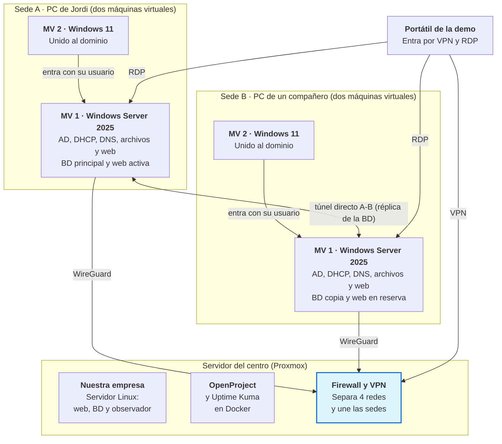

# Proyecto intermodular · 2º ASIR

Versión 0.7 · 19 de octubre de 2026 · Aprobada por el grupo

Montamos dos empresas ficticias y las conectamos: **la nuestra**, una pequeña empresa de servicios informáticos con taller, y **su primer cliente**, una empresa de importación y distribución con dos sedes, en Granada (sede A) y Málaga (sede B). Nuestra empresa vive en un servidor del centro; cada sede del cliente, en el PC de un miembro del grupo, unidas por una VPN. Lo defenderemos en 30-40 minutos, con una demostración en directo en la que cae una sede y la otra toma el relevo.

Este README es el resumen. El detalle está en la [documentación](#documentación).

> [!TIP]
> **Cómo leerlo según el tiempo que tengas:**
> - **5 minutos:** este README.
> - **Lo de tu módulo:** la tabla [Dónde está cada módulo](#dónde-está-cada-módulo).
> - **Todo el proyecto:** los documentos de [`docs/`](docs/) en orden, del 10 al 90.
> - **Para montar algo:** los [manuales](docs/manuales/), también numerados por orden de uso.

## El proyecto en cinco puntos

- **Nuestra empresa** vive en un servidor Linux del centro (Proxmox): cuatro redes separadas por un firewall virtual, web con blog, intranet de reparaciones, base de datos Oracle, OpenProject y un panel de estado (Uptime Kuma).
- **La empresa cliente** tiene dos sedes, en Granada (A) y Málaga (B), y comerciales de calle por toda España. Cada sede es un **Windows Server 2025** que lo hace todo (Active Directory, DNS, DHCP, archivos, base de datos y web) y un cliente **Windows 11** unido al dominio.
- **Las sedes se unen por VPN** (WireGuard) entre ellas y con el servidor del centro. La base de datos **Oracle** tiene la principal en la sede A y una copia continua en la B. Si cae la A, se promueve la B. PostgreSQL queda como plan B.
- **La defensa**: un portátil del centro hace de técnico de nuestra empresa, entra en las dos empresas y vemos caer la sede A y recuperarse. Antes, un bloque breve de IPE II sobre cómo nació nuestra empresa.
- **Lo que solo se documenta**: copias de seguridad completas, SAI, el despliegue de equipos por red, la tienda y el taller de nuestra empresa, y las medidas de seguridad más avanzadas.

## Esquema de la red

Ver o editar el diagrama como texto (Mermaid)

## Qué está decidido y qué no

| Estado | Tema | Detalle |
| --- | --- | --- |
| Decidido | Dónde va cada cosa | Nuestra empresa, en el servidor del centro. Sede A, en el PC de Jordi. Sede B, en el PC de un compañero (casi seguro), con un portátil del centro como alternativa |
| Decidido | Sistemas | Linux y Docker en nuestra empresa; Windows Server 2025 y Windows 11 en las sedes |
| Decidido | Base de datos | Oracle en las sedes (visto bueno de ASGBD), con réplica de A a B y promoción manual. PostgreSQL 18 como plan B |
| Decidido | VPN | WireGuard, con el concentrador en el servidor del centro y un túnel directo entre sedes para la réplica |
| Decidido | Webs | nginx con certificados de una CA propia (openssl). Web del cliente en Python |
| Decidido | Herramientas | GitHub para la documentación y OpenProject para la planificación |
| Pendiente de confirmar | Edición de Oracle | La réplica con promoción (Data Guard) solo está en la edición Enterprise. Hay que confirmar qué edición y licencia nos da el centro y si funciona en Windows Server 2025 |
| Pendiente | Servidor del centro | El docente está de acuerdo; previsto en un par de semanas |
| Por decidir | Nombres de las dos empresas | Entre todos. Bloquean el dominio de AD, los nombres DNS y los certificados |
| Por decidir | Restauración de copia en la defensa | Si se demuestra y cómo, por el tiempo limitado |
| Por decidir | Motivo de la caída de la sede A | El gato que pulsa el botón de apagado o similar, a ser posible con gracia |

## La defensa en 40 minutos

| Bloque | Minutos |
| --- | --- |
| IPE II: cómo nació nuestra empresa (preliminar) | 8-10 |
| Diseño de la infraestructura: diagrama y decisiones | 6-8 |
| Demo: el técnico entra en las dos empresas | 6-8 |
| Demo: cae la sede A y la B toma el relevo | 5-6 |
| Limitaciones, mejoras y cierre | 3-4 |
| Margen para imprevistos y preguntas | 4-5 |

Guion completo en [La demostración](docs/20-demostracion.md).

## Calendario

| Hito | Fecha prevista |
| --- | --- |
| Decisiones previas cerradas | Principios de noviembre de 2026 |
| Sedes A y B con Active Directory | Finales de noviembre |
| Túnel entre sedes y réplica de la base de datos | Diciembre |
| Webs con HTTPS y nuestra empresa completa en el centro | Enero de 2027 |
| Demo completa probada | Principios de febrero, antes de las prácticas |
| Prácticas en empresa (sin trabajo en el proyecto) | Mediados de febrero a mediados de abril |
| Memoria, ensayos y defensa | Finales de mayo (fecha por confirmar) |

El planning detallado, con fases, hitos y tareas, está en OpenProject.

## Dónde está cada módulo

| Módulo | Dónde mirar |
| --- | --- |
| SRI y Contenedores | [Infraestructura y ubicación](docs/10-diseno-tecnico.md#infraestructura-y-ubicación) y [servicios](docs/10-diseno-tecnico.md#servicios-y-para-qué-sirven) (DNS, DHCP, VPN, nginx, Docker), y los [manuales](docs/manuales/) de la VPN y de OpenProject |
| ASO | [La empresa cliente](docs/10-diseno-tecnico.md#la-empresa-cliente) (Active Directory, GPO, carpetas compartidas, despliegue de equipos) y las plantillas con Sysprep en [Infraestructura](docs/10-diseno-tecnico.md#infraestructura-y-ubicación) |
| SAD | Seguridad de [nuestra empresa](docs/10-diseno-tecnico.md#nuestra-empresa) y de [las sedes](docs/10-diseno-tecnico.md#la-empresa-cliente), copias de seguridad y SAI, y [riesgos y limitaciones](docs/30-riesgos-y-limitaciones.md) |
| IAW | [Sitio web y base de datos](docs/10-diseno-tecnico.md#sitio-web-y-base-de-datos) (web en Python, nginx, certificados) y [autenticación](docs/10-diseno-tecnico.md#cómo-se-autentican-los-usuarios-en-el-sitio-web) |
| ASGBD | [Sitio web y base de datos](docs/10-diseno-tecnico.md#sitio-web-y-base-de-datos) (Oracle con Data Guard, stock y precios) y la base de datos de [nuestra empresa](docs/10-diseno-tecnico.md#nuestra-empresa) |
| IPE II | [IPE II](docs/40-ipe-ii.md): cómo nació nuestra empresa |
| Proyecto (coordinación) | [Seguimiento](docs/50-seguimiento.md): preguntas pendientes, contenidos por ver e historial de versiones |

## Documentación

| Documento (por orden de lectura) | Qué contiene |
| --- | --- |
| [10 · Diseño técnico](docs/10-diseno-tecnico.md) | Las dos empresas, la infraestructura, los servicios, la red, la web, la base de datos y la autenticación |
| [20 · La demostración](docs/20-demostracion.md) | Guion de la defensa, acceso remoto y comprobaciones del día antes |
| [30 · Riesgos y limitaciones](docs/30-riesgos-y-limitaciones.md) | Qué puede fallar, el plan B de cada cosa y qué haríamos si la empresa creciera |
| [40 · IPE II](docs/40-ipe-ii.md) | La parte de empresa: cómo nació nuestra empresa (preliminar) |
| [50 · Seguimiento](docs/50-seguimiento.md) | Preguntas pendientes, contenidos por ver, notas e historial de versiones |
| [90 · Glosario](docs/90-glosario.md) | Los tecnicismos del proyecto, explicados |
| [Manuales](docs/manuales/) | Procedimientos paso a paso: [10 · montaje de la VPN de OpenProject](docs/manuales/10-montaje-vpn-openproject.md), [20 · conectarse a OpenProject por VPN](docs/manuales/20-conexion-vpn-openproject.md) y [30 · acceso al servidor del centro](docs/manuales/30-acceso-servidor-centro.md) (provisional). Numerados por orden de uso |

## Estado actual

- **OpenProject** funciona de forma provisional en una máquina virtual del PC de Jordi, con fases e hitos del planning. Se migrará al servidor del centro cuando esté disponible.
- **VPN WireGuard** montada y probada desde fuera de casa; los compañeros y los docentes entran a OpenProject con su propio perfil.
- **Sede A**: Windows Server 2025 instalado y actualizado.
