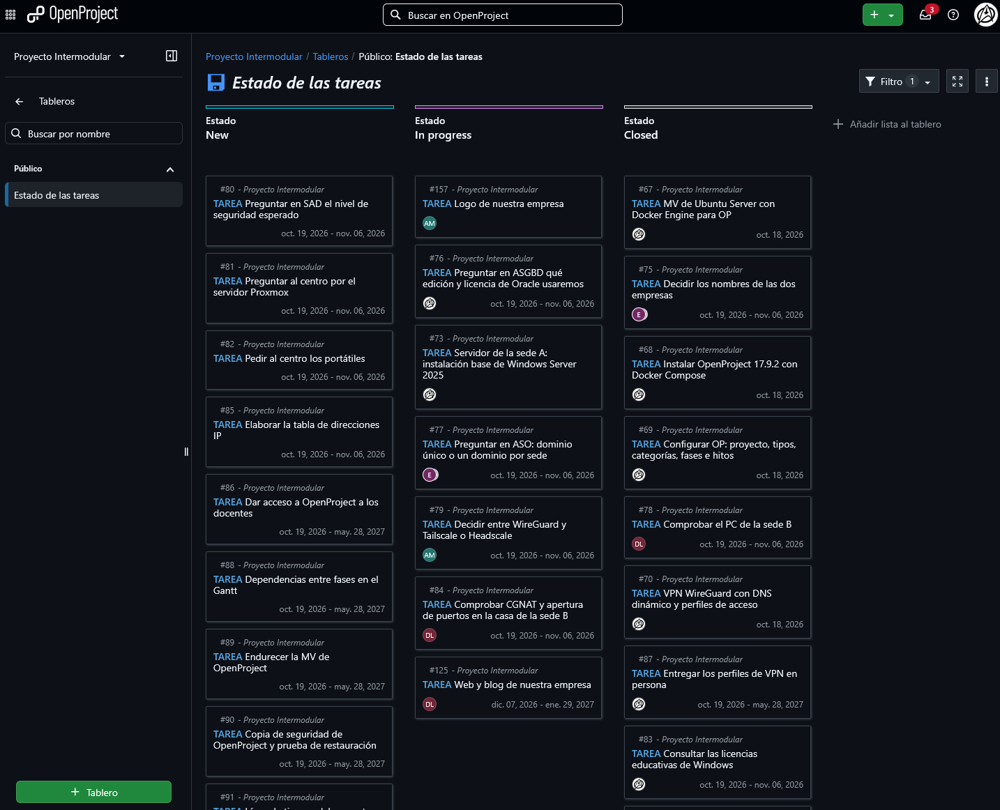

# IPE II: cómo nació nuestra empresa

[Inicio](../README.md) · [Índice de la documentación](README.md)

> [!NOTE]
> **Versión inicial.** Este documento se amplía conforme avanza el módulo de IPE II. Los datos de Coral IT y de Dextro Imports son especulaciones.

## Qué vamos a contar

Una explicación breve, de **10 minutos como máximo**, al principio de la defensa: cómo nació nuestra empresa, Coral IT, y cómo ha crecido hasta dar servicio a su primera empresa cliente, Dextro Imports. Aquí se ve qué contenidos de IPE II aplicamos y cómo, con ejemplos del propio proyecto.

## De dónde venimos

Coral IT empezó como un taller de venta y reparación de ordenadores (de las impresoras, mejor no hablar). Además de reparar, nos gusta restaurar equipos y videoconsolas antiguos, y de ahí viene una idea que hoy es parte del negocio: **reacondicionar** equipos usados para que vuelvan a funcionar.

Dextro Imports se dedica a la importación y distribución de artículos de regalo, tiene dos oficinas y ya contaba con un sistema informático, aunque limitado. Nuestro paso nuevo es ayudarle a modernizarlo.

## Lean Startup: probar antes de construir

Partimos de algo que ya funcionaba: un taller con clientes. Lo que probamos ahora es un servicio distinto, ayudar a una empresa a mejorar su sistema. Nuestra «versión mínima» es la demostración del proyecto: algo pequeño y real con lo que comprobar si el cliente lo valora, antes de construir más. Si funciona, se amplía; si no, se corrige. Es el ciclo de **crear, medir y aprender** del temario.

## Qué nos contó Dextro Imports (entrevista de problema)

Antes de proponer nada, entrevistamos a los responsables de la empresa con preguntas abiertas, sin ofrecer soluciones. Por ejemplo: *«¿Cómo consultan hoy el stock los comerciales cuando están en la calle?»* o *«¿Qué pasó la última vez que una oficina se quedó sin sistema?»*. Esto es lo que descubrimos y lo que hicimos:

| Lo que nos contaron | Lo que hicimos | Dónde verlo |
| --- | --- | --- |
| Los comerciales consultan el stock por teléfono y a veces se equivocan | Un sitio web para consultar el stock desde el móvil | [Acceso de los comerciales](10-diseno-tecnico.md#cómo-se-autentican-los-usuarios-en-el-sitio-web) |
| Si una oficina se queda sin sistema, se para todo | Una copia de los datos en la otra oficina, para seguir trabajando | [Sitio web y base de datos](10-diseno-tecnico.md#sitio-web-y-base-de-datos) |
| No tienen informático propio | Los atendemos a distancia, sin desplazarnos | [La demostración](20-demostracion.md) |

## Economía circular: reparar y reacondicionar

Reparar en lugar de tirar es la base de Coral IT. Según las «R» de la economía circular (y el objetivo de desarrollo sostenible 12, producción y consumo responsables), lo aplicamos así:

| «R» | Cómo la aplicamos |
| --- | --- |
| **Reducir** | Un solo servidor en lugar de varios: se virtualizan los servicios |
| **Reutilizar** | El proyecto usa equipos que ya existen (los PC del grupo y el servidor del centro) en lugar de comprar hardware nuevo |
| **Reparar** | Es nuestro oficio: arreglar antes de sustituir |
| **Renovar** (reacondicionar) | Ponemos a punto equipos usados para darles una segunda vida |
| **Reciclar** | Lo que ya no tiene arreglo va a un gestor autorizado de residuos electrónicos |

## Balance social: qué aporta Coral IT

El **balance social** es la herramienta con la que una empresa evalúa y cuenta su desempeño social, laboral y medioambiental, más allá de los resultados económicos. Forma parte de su **responsabilidad social corporativa (RSC)**. Lo incluimos porque lo que hace Coral IT (reparar y reacondicionar equipos) encaja con el modelo ecosocial de **extensión de la vida útil del producto**: que lo que ya existe dure más.

> [!NOTE]
> Las cifras son especulativas, como el resto de datos de Coral IT.

| Área | Indicador | Valor orientativo | Principio de RSC |
| --- | --- | --- | --- |
| Ambiental | Equipos reparados en lugar de sustituidos | Unos 600 al año | Sostenibilidad ambiental |
| Ambiental | Equipos reacondicionados y vendidos con garantía | Unos 150 al año | Sostenibilidad ambiental |
| Ambiental | Residuos electrónicos (RAEE) entregados a un gestor autorizado | Todo lo que no se puede reaprovechar | Gobernanza y cumplimiento legal |
| Laboral | Formación técnica de la plantilla | Unas 20 horas por persona y año | Respeto a los derechos humanos y laborales |
| Comunidad | Equipos reacondicionados donados a asociaciones o centros educativos | Unos 20 al año | Contribución al bienestar social |
| Transparencia | Presupuesto y diagnóstico por escrito antes de reparar, y recomendación honesta de no reparar cuando no compensa | Siempre | Transparencia y rendición de cuentas |

**Conclusión:** el balance es **positivo**. La actividad principal ya alarga la vida útil de los equipos y lo que no se puede aprovechar se recicla por vías autorizadas. Como mejoras, medir con más precisión los kilos de residuo evitado y formalizar las donaciones mediante convenios.

Base teórica: Unidad 7 de IPE II (responsabilidad social corporativa, balance social y modelos de negocio ecosociales).

## Cómo nos organizamos (metodología ágil)

Trabajamos con un tablero de tareas, **OpenProject**, donde cada tarea avanza de «por hacer» a «hecho» a la vista de todos. Las tareas se reparten por lotes y se revisa el avance con el grupo, ajustando sobre la marcha: es el trabajo por pequeños pasos que propone la metodología ágil.

## Propiedad intelectual y uso de herramientas de IA

- **Licencias:** usamos software libre o de uso gratuito (OpenProject en su edición Community, WireGuard, nginx, Uptime Kuma, PostgreSQL y Docker) y versiones de evaluación de Windows (supuesto del proyecto). Citamos las fuentes de lo que consultamos.
- **Uso de herramientas de IA.** En este proyecto se han utilizado asistentes de inteligencia artificial para estructurar, redactar y revisar parte de la documentación, y para resolver dudas técnicas. Las decisiones de diseño, la configuración y las pruebas las realiza el grupo, y todo el contenido generado se revisa y adapta antes de incorporarlo.

## Pendiente

- [ ] Estudio previo de mercado y tarifas de Coral IT.
- [ ] Ampliar el balance social con más indicadores y cifras reales, según oriente el docente.
- [ ] Añadir más contenidos del temario conforme avance el módulo.

---

[← Riesgos y limitaciones](30-riesgos-y-limitaciones.md) · [Índice](README.md) · [Glosario →](90-glosario.md)
